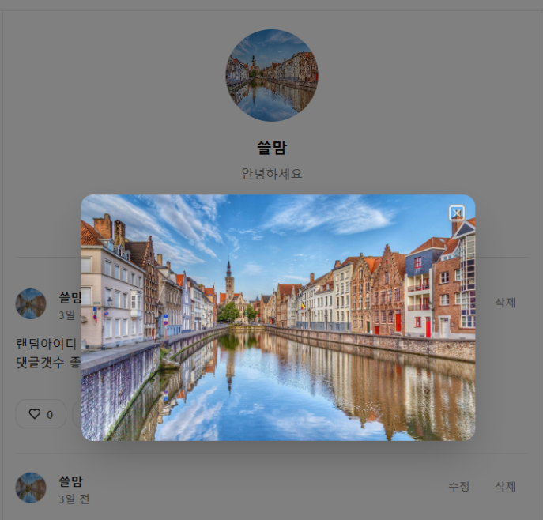
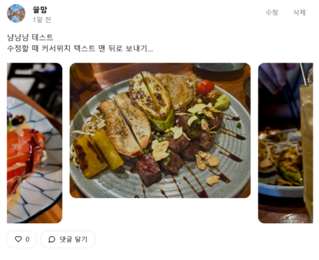

# 한입 로그 (onebite-log)

React + Supabase로 만든 SNS 웹 애플리케이션입니다.

**🔗 배포 주소: https://onebite-log-sigma.vercel.app/sign-in**

> '한입 크기로 잘라먹는 리액트' 강의를 따라 만든 프로젝트입니다. 배포 이후에도 직접 리뉴얼하고 보완 작업을 이어가고 있습니다.

## 주요 기능

- **인증**: 이메일 회원가입 / 로그인, GitHub 소셜 로그인, 비밀번호 재설정(이메일 발송 → 새 비밀번호 설정)
- **게시글**: 작성 · 수정 · 삭제, 이미지 여러 장 업로드(캐러셀로 표시)
- **피드**: 무한 스크롤(`useInfiniteQuery`)로 게시글 목록 조회
- **좋아요**: 게시글 좋아요 토글
- **댓글**: 작성 · 수정 · 삭제
- **프로필**: 사용자 프로필 페이지, 프로필 정보 및 이미지 수정
- **라이트 / 다크 테마**
- **라우트 보호**: 로그인 사용자 전용 / 비로그인 전용 레이아웃 분리

## 직접 추가한 기능 (강의 외)

- **프로필 사진 확대 보기**: 프로필 사진을 클릭하면 모달로 원본 이미지를 크게 볼 수 있습니다. (Radix Dialog 활용, 호버 시 밝기 변화로 클릭 가능함을 표시)
- **이미지 캐러셀 크기 보정**: 여러 장의 이미지를 올렸을 때 크기가 맞지 않던 부분을 수정해 비율이 다른 사진도 일정한 높이로 보이도록 했습니다.
- **게시글 수정 시 커서 위치 개선**: 수정 모달을 열면 커서가 본문 맨 뒤에 위치해 바로 이어서 입력할 수 있습니다.

| 프로필 사진 확대 | 이미지 캐러셀 |
| --- | --- |
|  |  |

## 기술 스택

| 분류 | 사용 기술 |
| --- | --- |
| Frontend | React 19, TypeScript, Vite |
| 라우팅 | React Router 7 |
| 스타일 | Tailwind CSS 4, shadcn/ui(Radix UI), lucide-react |
| 서버 상태 | TanStack React Query 5 (무한 쿼리, 캐싱) |
| 클라이언트 상태 | Zustand + Immer |
| Backend | Supabase (PostgreSQL, Auth, Storage) |
| 배포 | Vercel |
| 코드 품질 | ESLint, Prettier |

## 폴더 구조

```
src
├─ api/          Supabase 호출 (auth, post, comment, profile, images)
├─ components/   post · comment · profile · modal · layout · ui
├─ hooks/        queries / mutations (React Query 훅)
├─ store/        Zustand 스토어 (세션, 모달, 테마)
├─ pages/        라우트별 페이지
└─ lib/          Supabase 클라이언트, 유틸
```

## 실행 방법

```bash
npm install
cp .env.example .env   # Supabase 프로젝트 URL / anon key 입력
npm run dev
```

`.env`에는 본인의 Supabase 프로젝트 값이 필요합니다. 테이블과 스토리지 버킷은 `src/database.types.ts`의 스키마를 참고해 구성할 수 있습니다.
